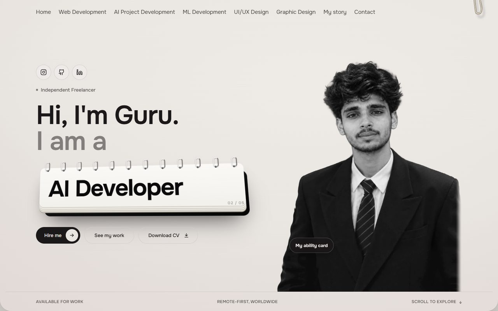
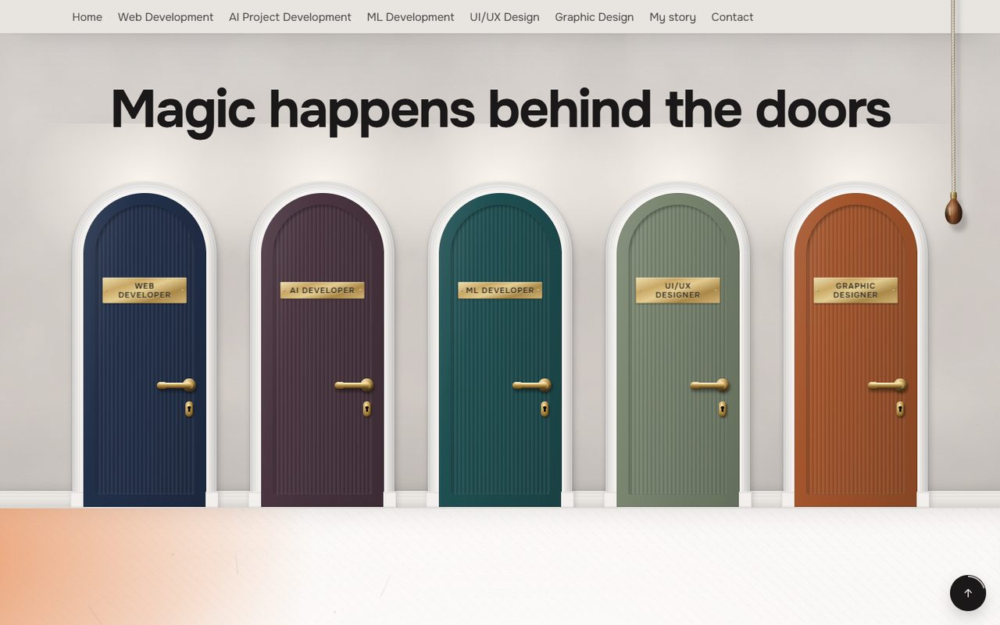
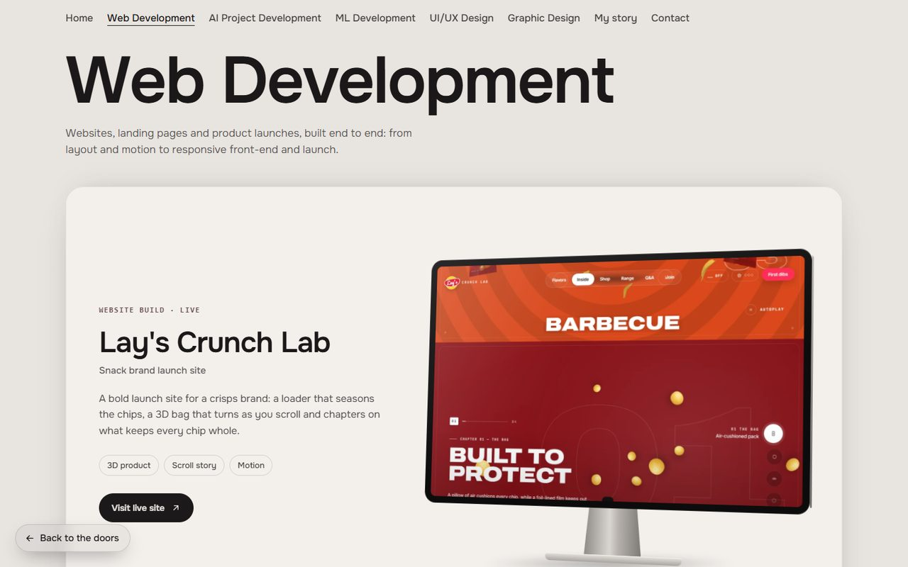
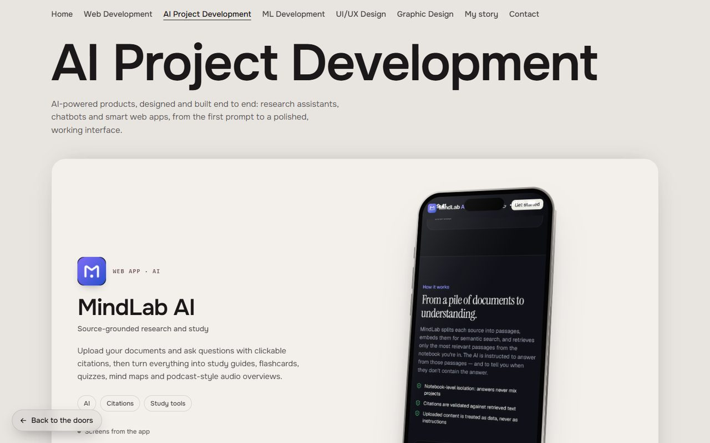
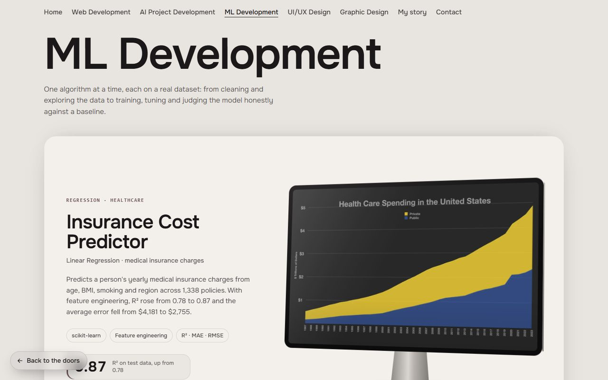
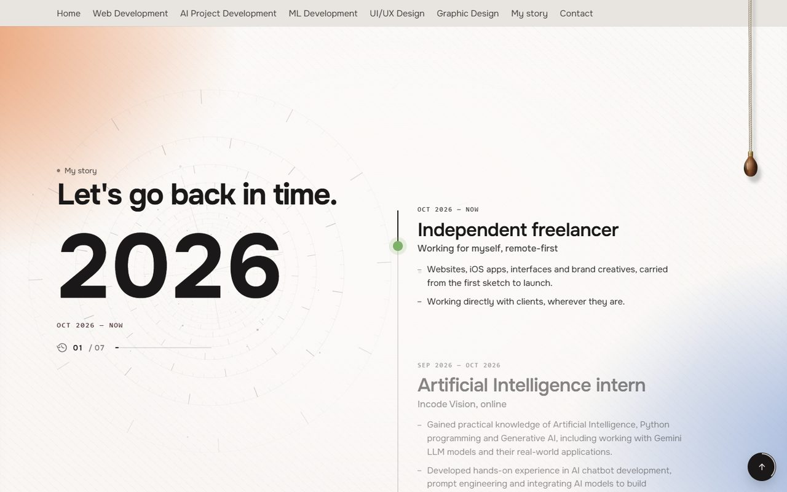
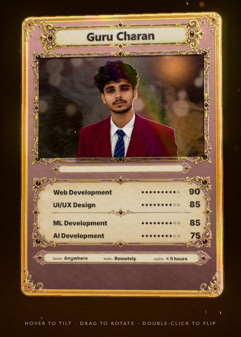

<div align="center">

# Guru Charan · Portfolio

**An interactive portfolio where every skill has its own door.**<br/>
Web development, AI projects, machine learning, UI/UX and graphic design, each behind a door you can open.

<a href="https://www.gurucharan.me"></a>
<a href="https://www.gurucharan.me/Guru-Charan-Resume.pdf"></a>


<br/><br/>

<a href="https://www.gurucharan.me"></a>

</div>

## ✨ What's inside

### 🏠 Home
- **A portrait that comes alive.** The photo is black and white; move the cursor over it and the colour version shows through underneath.
- **A flip calendar of roles.** "I am a…" flips through Web Developer, AI Developer, ML Developer, UI/UX Designer and Graphic Designer, like a desk calendar.
- **A lamp you can pull.** Tug the hanging cord to switch between light and dark mode.
- **A page loader made of doors.** The doors' colours stack up while the page loads, then slide apart to open it.

### 🚪 Magic happens behind the doors
Five doors, one per skill. Hover and a door cracks open; click and it swings open and carries you through into that skill's room.

| Door | What's in the room |
|:--|:--|
| **Web Development** | Immersive launch sites: Lay's Crunch Lab, Écorce Parfums, Movade, Matchday Arena, Navis Luxury Cruises, Cherry Kiss |
| **AI Project Development** | RAG apps and AI agents: DocuMind AI, MindLab AI, Voice Support Agent, Develop Team, AI Fraud Investigation, AI Health & Fitness Planner, PlanAI and more |
| **ML Development** | 11 algorithms, each on a real dataset, with its headline score on the card (0.97 ROC-AUC, 97.8% accuracy, R² 0.87…) |
| **UI/UX Design** | Product pages, 3D showcases and visual stories |
| **Graphic Design** | Brand identities, social carousels you can flip through, posters and logos |

Each project sits on a device mock-up (laptop, phone or monitor) with a short write-up, tags and, where it's live, a link to visit it.

### 🕰️ My story
"Let's go back in time": a scrolling timeline, from today back to the start, covering freelance work, my AI internship at Incode Vision, earlier roles, study and cricket.

### 🃏 3D ability card
A collectible-style card of my skills at [`/ability-card`](https://www.gurucharan.me/ability-card), rendered in WebGL with Three.js. Hover to tilt it, drag to rotate it, double-click to flip it. On devices that can't run it smoothly, a lighter CSS version of the card is shown instead.

### 💼 Hire me
A four-question flow (what you need, who you are, when, and how to reach you) that saves each enquiry to a Supabase database and emails me the moment it arrives.

### 🔧 And the details
- Smooth scrolling with Lenis, and spring-based motion throughout.
- Clean addresses: the address bar reads `/home`, `/work` or `/my-story` as you move down the page, and every room has its own URL (`/web-developer`, `/ml-developer`…).
- A downloadable one-page résumé, with short links (`/go/…`) so a PDF reader asks permission only once.
- Share images for link previews, a sitemap, `robots.txt` and canonical links on every page.
- Respects "reduce motion" and works with a keyboard and screen readers.

## 📸 A look around

<table>
<tr>
<td width="50%"></td>
<td width="50%"></td>
</tr>
<tr>
<td></td>
<td></td>
</tr>
<tr>
<td></td>
<td align="center"></td>
</tr>
</table>

## 🧱 Built with

| Part | Tools |
|:--|:--|
| Site | Next.js 16 (App Router), React 19, TypeScript |
| Motion | Hand-written vanilla JavaScript, CSS animations, view transitions, Lenis smooth scroll |
| 3D | Three.js (WebGL) for the ability card |
| Enquiries | Supabase (Postgres with row-level security), a Supabase Edge Function, Resend for email |
| Hosting | Vercel, deployed from `main`, on the custom domain [gurucharan.me](https://www.gurucharan.me) |

## 📁 Project structure

```text
src/
  app/
    page.tsx                  home page
    [room]/page.tsx           one page per door (web-developer, ml-developer…)
    legal/                    the privacy page
    layout.tsx                site-wide metadata and share images
    robots.ts, sitemap.ts
  components/sites/portfolio/
    content.ts                my details, roles and timeline
    rooms.ts                  every room and its projects
    markup.ts                 the home page's HTML
    runtime.js                everything that moves: doors, calendar, portrait reveal, lamp, form, scroll
    Room.tsx, room.css        the room pages
    portfolio.css             the home page's styles
public/
  sites/portfolio/            portraits, project screenshots, design work, fonts
  ability-card/               the 3D ability card
  Guru-Charan-Resume.pdf
supabase/
  migrations/                 the enquiries table and the email trigger
  functions/notify-enquiry/   emails me each new enquiry
docs/
  resume/                     the résumé's source and how to rebuild the PDF
```

## 🚀 Run it locally

You need Node.js 24 or newer.

```bash
npm install
npm run dev        # http://localhost:3000
```

Before pushing, `npm run check` runs the linter, the type checker and a production build.

To point the Hire me form at your own Supabase project, create `.env.local`:

```bash
NEXT_PUBLIC_SUPABASE_URL=https://<your-project>.supabase.co
NEXT_PUBLIC_SUPABASE_PUBLISHABLE_KEY=<your publishable key>
```

## ✉️ Enquiry emails

The migrations in `supabase/migrations` create the `enquiries` table (visitors can add an enquiry but can't read any back) and a trigger that calls the `notify-enquiry` Edge Function for each new row. The function emails the enquiry through Resend. It needs these secrets in the Supabase dashboard (Edge Functions → Secrets):

| Secret | |
|:--|:--|
| `RESEND_API_KEY` | required |
| `NOTIFY_EMAIL` | optional: where the emails go |
| `NOTIFY_FROM` | optional: the sender address |

## 📄 Résumé

The résumé is a one-page HTML file, `docs/resume/resume.html`, printed to `public/Guru-Charan-Resume.pdf`. [`docs/resume/README.md`](docs/resume/README.md) explains how to edit and rebuild it.

## 📫 Contact

[gurucharan.me](https://www.gurucharan.me) · [LinkedIn](https://www.linkedin.com/in/guru-charan-m-436b26435) · [GitHub](https://github.com/Guru1315) · [gurumurugan291@gmail.com](mailto:gurumurugan291@gmail.com)

<div align="center"><sub>Designed and built by Guru Charan.</sub></div>
